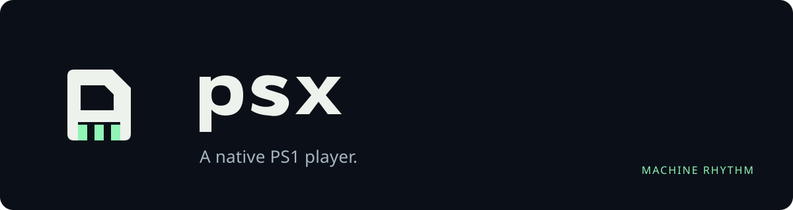

# psx

A native PlayStation player, with working PS1 playback and PS2 integration
under development. Choose your games, make yourself comfortable,
and play. Built by Machine Rhythm, starting with Android foldables.

- A local game library with explicit storage scanning and multi-disc support.
- A large, unstretched picture, separate from the controls by default.
- A following D-pad, simultaneous touch input and press haptics.
- Movable, resizable controls with separate saved display layouts.
- Compact in-game settings, volume, pause and a tap/hold time control.
- Durable memory cards and automatic session resume.

No accounts, analytics, uploads or bundled games. Your games, firmware and
saved progress stay on your device.

## Development status

Actual hardware-rendered gameplay, clear sound, simultaneous controls and an
ordinary memory-card save loaded after a fresh process have run on a stock
Fold. Automatic session restore has also returned to gameplay after a fresh
process. Reopening now reuses the existing player, and the owner has checked
fold/rotation layouts. The latest build restored FF7 and booted Crash with
the free firmware; startup latency, controller snapping and the latest
background-audio refinement still need focused device checks.

This is active development, with a signed development APK build path.
Google Play and Apple App Store releases are intended; store acceptance,
16 KB Android runtime and stock-iOS performance remain unverified.
See [observed results and limits](docs/verification.md).

## Build and contribute

```sh
git clone --recurse-submodules https://github.com/WigglyDon/psx
cd psx
```

[Build instructions](docs/build.md) cover the Rust/Android tools, APK and
corresponding-source archive. [PLAYER-2](https://github.com/WigglyDon/psx/issues/2)
tracks active PS2, direct-game shortcut and independent-session work. The
working PS1 baseline and its remaining qualifications stay recorded in
[FIRST-PLAYABLE-1](https://github.com/WigglyDon/psx/issues/1).

| Document | Purpose |
| --- | --- |
| [Architecture](docs/architecture.md) | Execution, platform and interface boundaries |
| [Files and saves](docs/formats.md) | Supported inputs, storage access and recovery |
| [Distribution](docs/distribution.md) | Core licensing and eventual store requirements |
| [AGENTS.md](AGENTS.md) | Development instructions |

## Source and attribution

Original psx code and [brand artwork](assets/brand/README.md) use **MIT**.
The pinned [SwanStation](https://github.com/libretro/swanstation) core retains
its upstream C++ and GPL terms. It derives from DuckStation; psx does not
claim authorship of either emulation engine. All new player and host logic
is Rust, behind a narrow libretro C interface.

A combined distribution must satisfy the core's applicable GPL requirements;
MIT and FFI do not remove them. See [THIRD_PARTY.md](THIRD_PARTY.md),
[LICENSE](LICENSE) and [upstream.lock.json](upstream.lock.json). Core,
dependency and font notices are retained in source and the APK.

Game images and proprietary firmware are not distributed here. PlayStation
is a Sony trademark; this independent project is not affiliated with Sony.
